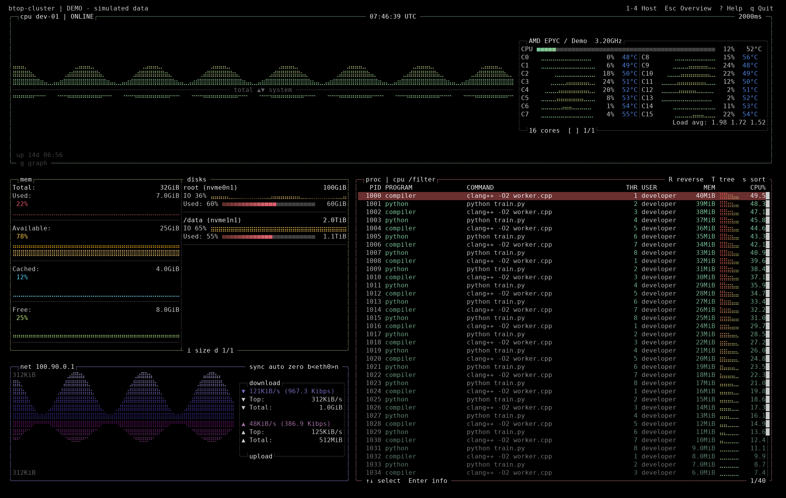

# pto-btop

A Linux terminal monitor for up to four machines, using btop's original drawing
primitives, themes and CPU / memory / disks / network / process layout.

Agents send metrics to an HTTPS hub. Each terminal viewer has independent host
selection, process filters and sorting. Any monitored machine can also run a
viewer; one machine runs the hub. NetBird provides connectivity, and the monitor
verifies HTTPS certificates and uses separate agent and viewer credentials.



**Version:** `0.5.1`, with deduplicated login counts and task-submit
card allocation monitoring. Local Linux ARM64 collection, three-agent HTTPS tests
and independent terminal sessions are covered. Check the [amd64 / arm64 build results](https://github.com/pypto-tools/pto-btop/actions/workflows/release.yml)
for CI validation and [Releases](https://github.com/pypto-tools/pto-btop/releases)
for published packages; a version in the source tree is not a published release.

## Install

Packages are named `pto-btop-VERSION-linux-amd64.tar.gz` and
`pto-btop-VERSION-linux-arm64.tar.gz`. Select the package matching `uname -m`
(`x86_64` → `amd64`, `aarch64` → `arm64`). Each package includes all three programs,
themes, a configuration generator, installation tooling and licenses.

Runtime requirements: Linux with glibc 2.28+, and Python 3.10+ for
installation/configuration. Release packages bundle OpenSSL 3.5.9; a system
OpenSSL 3 installation is not required. The package records its actual minimum
glibc version in `package.json` and checks compatibility before installation.
Release builds bundle the GCC C++ runtime. These are not musl/Alpine packages.

After downloading a package and its `.sha256` file:

```bash
sha256sum --check pto-btop-0.5.1-linux-arm64.tar.gz.sha256
tar -xzf pto-btop-0.5.1-linux-arm64.tar.gz
cd pto-btop-0.5.1-linux-arm64
python3 install.py --check
python3 install.py --root "$HOME/.local/share/pto-btop" --bin-dir "$HOME/.local/bin"
"$HOME/.local/bin/pto-btop" --local --detail
```

Substitute `amd64` on x86 machines. The example uses a user-owned directory.
Organization defaults are `/home/pypto-tools/pto-btop` and `/usr/local/bin`;
the installing account must have write access to both. Installation does not
enable services or create enrollment credentials. Upgrades preserve configuration
and state; [installation and release guide](docs/cluster/release.md) has details.

If you already have a private node enrollment bundle (`node.json` and `node/`),
download the release
[`setup.py`](https://github.com/pypto-tools/pto-btop/releases/download/v0.5.1/setup.py)
and its `.sha256` file into that directory. Verify the checksum, then run
`python3 setup.py --proxy http://127.0.0.1:7892` to install and start the agent.
`--check` only validates and does **not** install. See the
[uv and enrollment installation instructions](docs/cluster/release.md#已有节点配置时直接安装)
if the system Python is older than 3.10. Existing enrollment credentials are reused.

To share the monitor with every local login account, run the one-command
installer from the account with the existing private installation:

```bash
curl -fsSL https://raw.githubusercontent.com/pypto-tools/pto-btop/main/install.sh | bash
```

It requests sudo, detects the hub/node role and architecture, preserves enrollment,
and activates system services. Later run `sudo pto-btop-update` on each machine to
install GitHub Latest; an already-current deployment is left running. Python 3.9+
is sufficient. See [system-service deployment](docs/cluster/system-service.md)
for proxies, verification and recovery.

## Connect the machines

Use `scripts/https-init.py` from the extracted package, or
`app/current/scripts/https-init.py` after installation, to generate enrollment
for the hub's NetBird address. Give each node only its own configuration bundle.
See the [HTTPS guide](docs/cluster/https.md) for TLS, access control and services.

```bash
pto-btop-server --config /path/to/server/server.json
pto-btop-agent --config /path/to/node/agent.json
pto-btop --config /path/to/node/client.json --check
pto-btop --config /path/to/node/client.json --detail
```

In the detail view, press `/`, enter `user:dev`, and press Enter to show
processes whose username contains `dev` (case-insensitive). Plain text still searches
process names without case sensitivity. Clear the filter to show all processes.
User filtering requires version `0.4.0-alpha.3` or newer on the monitored **agent**;
existing configuration and the HTTPS hub remain compatible. After downloading the
new release installer into your enrollment directory, use
`setup.py --restart-agent` to install and activate the agent update.

Run the server once on the hub, an agent on each monitored machine, and a viewer
where needed. Run these foreground programs in separate terminals, or explicitly
enable the supplied service templates. Every viewer can switch among its allowed
hosts. `pto-btop --demo --detail` shows simulated data without a server.

The original executable names `btop-cluster`, `btop-agent` and `btop-server` remain
inside the package for compatibility. Public command names use the `pto-` prefix.

## Login and card resources

The overview includes available cards, running/pending tasks and unique login
accounts / sessions. Details keep CPU, memory, disks and network, and place a
card table above processes. Press `u` for login accounts, `v` to focus cards,
arrows to select a card, PgUp/PgDn to move by the visible page size, Enter for
allocation/reservation details, `f` to filter processes by the selected owner's
exact UID, and `o` to fold the card table. Press `,` / `.` to page cards directly;
these keys also expand and focus the card table. The footer shows selection and
page numbers, for example `4/8 p2/3`.
Manual `user:TEXT` filters remain case-insensitive substrings; `uid:1000` is exact.

Agents read Linux utmpx login records and query
`/usr/local/bin/task-submit --monitor --json` locally. Missing/unreadable sources
show unavailable, not zero; stale or maintenance snapshots never advertise free
cards. Card availability reflects the queue, not hardware health or a guarantee
that a new task can start. See [resource monitoring](docs/cluster/resources-monitoring.md).

Upgrade and restart the hub first, then each agent and viewer. New agents fall
back to five metric groups on older hubs; old agents continue working on new hubs
without the resource panels. Enrollment configuration does not change.

## Build and test

Build dependencies: GCC with full required C++23 support (GCC 14+), CMake 3.25+,
Ninja, nlohmann/json 3.11+, OpenSSL 3 development headers, GTest, Python 3.10+,
OpenSSL CLI and binutils. Pinning and build baseline are documented in the
[release guide](docs/cluster/release.md).

```bash
cmake -S . -B build/cluster -G Ninja \
  -DCMAKE_BUILD_TYPE=Release -DBTOP_CLUSTER=ON \
  -DBTOP_GPU=OFF -DBTOP_LTO=OFF -DBUILD_TESTING=ON \
  -DBTOP_CLUSTER_STATIC_CXX_RUNTIME=ON
cmake --build build/cluster --parallel 2
ctest --test-dir build/cluster --parallel 2 --output-on-failure
python3 scripts/package.py --build-dir build/cluster --output-dir dist \
  --max-glibc 2.36 --allow-shared-openssl
```

Release packaging rejects a glibc requirement above 2.28 or shared OpenSSL by
default. The example above explicitly permits a local development package.
Building directly on a newer distribution may therefore work locally but fail the release check. Use
the pinned manylinux CI containers, `scripts/build-release-deps.sh`, and
`-DBTOP_CLUSTER_STATIC_OPENSSL=ON` for distributable packages.

## Documentation and origin

- [Layout, controls and local/SSH modes](docs/cluster/prototype.md)
- [HTTPS deployment](docs/cluster/https.md)
- [Installation, upgrades and publishing](docs/cluster/release.md)
- [Architecture and design material](docs/cluster/README.md)
- [Repository operating skill](skills/pto-btop/SKILL.md)

This is an independent derivative of [aristocratos/btop](https://github.com/aristocratos/btop),
based on commit `e28a2701c7208ff00ab780a68287e2204f356ba0` (upstream version string
1.4.8). It is not an official btop release. The upstream license and copyright
notices are retained. See [LICENSE](LICENSE), [source record](docs/cluster/upstream.json),
and [third-party notices](docs/cluster/third-party.md).
