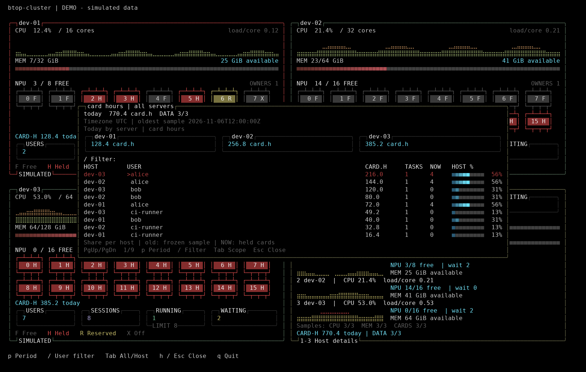

# 卡时统计（开发预览）

本地源码已提供 task-submit 卡时采集、HTTPS 转发和终端展示。此功能尚未进入正式发行包。

## 看预览

```bash
./build/cluster/btop-cluster --demo --demo-hosts 3 --usage
```

演示使用模拟数据；顶部有 DEMO 标记。按 h 或 Esc 关闭卡时页。



## 使用

- 总览的每台主机增加 CARD-H 摘要；三台布局的集群汇总显示卡时总数及 DATA 节点覆盖率。
- h 打开完整卡时页：总览默认所有主机，详情默认本机。Tab 在本机/所有主机之间切换。
- p 在今日、7 天、30 天之间切换，同一查看终端的各主机保持统一范围。
- / 输入用户名子串进行筛选，大小写不敏感；Enter 完成，Backspace 删除。筛选只影响用户表。
- 上下键逐行选择，PgUp/PgDn 按可见行数翻页，Home/End 到首尾。刷新保持所选身份，缩放自动调整页长。
- 详情按大写 H，在原 CARDS 区切换 devices / USAGE；按 p 切周期、Enter 或 h 展开。
- 逗号、句号继续直接打开设备列表并翻卡页；v 切 CARDS/PROC 焦点；CPU、MEM、DISKS、NET、PROC 保留。
- h 或 Esc 关闭完整卡时页；q 退出程序。

CARD.H 单位为卡时。TASKS 是所选窗口内有非零卡时的任务数，NOW 是当前可靠占卡数；
SHARE/HOST % 是用户占该服务器同期已知卡时的比例，不是 NPU 利用率。
今日以数字卡片对比服务器；7/30 天显示所选窗口的每日用量图。

完整窗口按内容大小居中，80×24 可以分页，TTY 主题和帧差分刷新继续使用。
历史不完整标记 *，仅在覆盖起点已知时显示日期；无数据或全部过期时不显示推测日期。
覆盖起点未知时仍显示“partial history”，解释 * 的含义。
失联/过期旧值标记 old，不继续增长。
同名账号按服务器及可信身份分别展示，不自动合并为同一个人。

## 接入真实数据

每台 task-submit 先提供 [schema 1 卡时接口](task-submit-usage-monitor-api.md)。
查询命令是 `task-submit --usage-monitor --json`，普通 agent 无需 sudo。
后台账本保留完成和运行中任务，按任务身份去重；不解析 `--stats` 的终端输出。
完成记录增量入库并缓存每日汇总，每轮只应用变化和补算运行中任务。首次导入或时区变化时
重建汇总，普通刷新复用缓存；完成目录有变化时核对元数据，每 5 分钟核对一次完成记录
内容，旧日报库变化时核对历史记录。源端内部优化不改变 schema 1，agent 和终端继续读取原有字段。

agent 的 card_usage 组独立每 30 秒采集，查询硬超时 1 秒，120 秒后标记过期。
中心通过 metric_groups 协商新增组，旧中心/agent 缺少能力时沿用现有指标。
HTTPS、证书、节点权限和查看配置保持现有结构。每个查看者的窗口、筛选和选择独立。

自然日由 `USAGE_MONITOR_TIMEZONE` 决定，默认 UTC。各服务器必须使用同一时区与窗口起点
才能合并总量；不一致时显示提示并排除不匹配节点。此配置与原有飞书日报时区独立。

建议先升级中心程序，再更新 task-submit 的 publisher 和各 agent，最后更新查看端。
本地预览不代表三台服务器已经部署。

## 验证记录

已覆盖统计去重、跨天/DST、失联冻结、历史覆盖、调用者配置隔离，普通用户只读查询、
临时安装及清理后历史保留；pto-btop 覆盖协议校验、真实 HTTPS、异步采集、
终端筛选/翻页/缩放和帧差分一致性。

原有完整 test_layout.sh 在当前普通账号下到 updater 的 root 所有权检查时退出；
新增卡时安装专项分别在普通账号和隔离 root 容器中通过，容器内另外以 nobody 查询验证权限。
