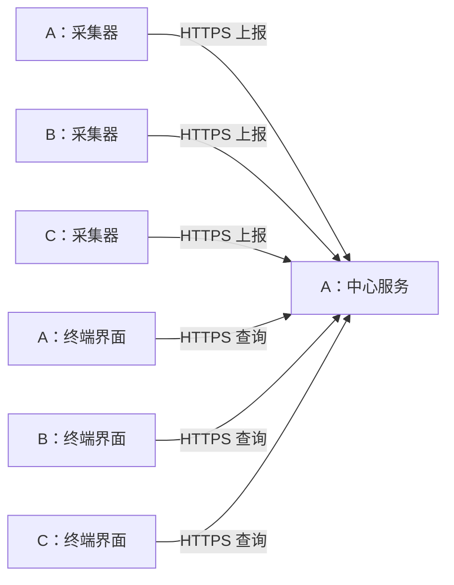

# 三机 HTTPS 集中接入方案

更新：2026-11-05。范围调整为三台 Linux 开发机，CPU 架构可能不同，每台都能打开终端界面查看全部主机。0.4.0 已按本方案实现中心、上报和读取，具体命令见 [HTTPS 使用说明](https.md)。本机管道／SSH 模式保留，真实三机仍待部署。

## 部署结构

| 机器 | 部署组件 | 职责 |
| --- | --- | --- |
| A：当前机器，拟作为中心节点 | agent、server、TUI client | 采集本机、汇总三台指标，同时可以查看界面 |
| B：开发机 | agent、TUI client | 采集并上报本机；查看全部主机 |
| C：开发机 | agent、TUI client | 采集并上报本机；查看全部主机 |

agent、server、TUI client 是三个角色，可以安装在同一台机器。每台受监控主机都需要自己的 agent；仅安装查看界面的 client 不会产生该主机的指标。

NetBird 提供主机之间的内网连通；监控使用 HTTPS 进行应用通信。SSH 可以用于安装或排障，监控运行时不要求 SSH 登录，也不要求开启 NetBird 内置 SSH。各 agent 主动连接中心，因此 B、C 无需为采集器新增监听端口。

中心可监听其 NetBird 地址的 TCP 8443，端口在部署时可调整。A 自身的 agent 和界面也使用相同 API，便于统一验证认证、重连和状态行为。真实目标三台的名称、地址和架构仍待确认；发现的其他 NetBird 节点不自动加入监控。

## 数据与界面行为

- 每台 agent 默认每 2 秒采样一次；无论打开多少界面，都共用该主机的采样结果。
- 中心保存最新快照、采样时间、接收时间和最近 300 个点的指标历史。默认约 10 分钟；一期保存在内存，不承诺重启后保留。
- 每个 TUI 独立保存所选主机、排序、过滤、网卡、磁盘页和进程选择，用户之间不共享键盘状态。
- 新打开的界面从中心读取已有基础指标历史；进程历史按查看订阅积累。
- 基础指标持续采集；进程的额外详情按活跃查看请求采集，有超时和数量上限。
- HTTP 请求在非阻塞网络层或工作线程完成，失败不阻塞按键、退出或终端局部刷新。
- 一期采用 HTTPS 快照查询和轮询；如以后需要降低轮询开销，再引入 SSE。

进程视图需要专门处理：当前 agent 的单订阅排序／过滤属于一个观察者。集中模式不能让一个用户的过滤修改所有人的结果。新的上报协议携带带标识的只读进程查询；agent 每轮扫描一次，在采集预算内分别形成各查询的结果，并保留每个查询的返回数、匹配数及截断状态。排序、过滤和 PID＋start_time_ticks 身份语义与当前界面保持一致。

每机最多 8 个进程查询、全中心最多 16 个；每查询最多 500 项。JSON 请求与响应限制为 8 MiB，超过限制返回 413；当前历史 API 尚未分页。历史保留 300 点，慢客户端只保留最新待发快照，不使其他查看者停止更新。

## 已实现 API

以下接口已实现，均要求对应角色的 Bearer 凭据：

| 接口 | 用途 |
| --- | --- |
| `POST /api/v1/agent/session` | 已授权 agent 建立会话，报告版本、主机和架构；不开放匿名注册 |
| `POST /api/v1/agent/snapshots` | 上报带会话、序号、采样时间的指标；响应可携带下一轮只读采集需求 |
| `GET /api/v1/hosts` | 主机列表及在线、过期、离线状态 |
| `GET /api/v1/hosts/{id}/snapshot` | 获取主机最新指标与对应进程视图结果 |
| `GET /api/v1/hosts/{id}/history` | 获取指定指标的有界历史窗口 |
| `POST /api/v1/views` | 建立／续期某个查看者的过滤、排序及进程详情需求 |
| `DELETE /api/v1/views/{id}` | 释放查看需求；客户端异常退出时由租约超时回收 |

继续复用现有 CPU、MEM、DISKS、NET、PROC 分组和指标单位。网络层使用 JSON 表达，不传输内存结构，因此不同架构之间可以互通。协议版本、会话身份、重复序号、旧连接迟到数据和消息大小在服务端校验。

查看接口只提供监控数据和采集需求，不提供任意 shell 命令、杀进程或修改远端系统的接口。

## 证书与权限

HTTPS 服务端证书的 SAN 应覆盖实际使用的 NetBird DNS 名称或地址。私有 CA 部署时，把 CA 证书安装到 agent／client 的信任配置；证书校验纳入接入自检。

使用每机独立的 agent 凭据和独立的只读 viewer 凭据。agent 凭据绑定 host_id，仅能上报所属主机；viewer 凭据可以查询授权主机及创建有界的查看需求。真实凭据存放在配置目录的受限文件中，不写入示例、仓库或日志。

NetBird 策略允许指定三台访问中心服务端口。应用认证、NetBird 网络访问策略和 TLS 分别负责应用权限、网络范围与服务端身份校验。

## 失败与重连

- 默认周期下，中心超过 6 秒未收到某主机样本标记 STALE，超过 10 秒标记离线；采样周期改变时同比调整。
- 保留最后一份快照并展示其时间；曲线对采样间隙做标记，不把陈旧值重复追加成新样本。
- agent 断线后退避重连；限制积压，只恢复当前数据，一期不承诺完整补传断线期间历史。
- 中心不可用时，TUI 显示连接状态和最后数据时间；恢复后重新取得快照及历史。中心是一期单点，暂无高可用承诺。
- 多个查看者断开不影响后台基础指标采集；额外进程详情在查看租约过期后停止。

## 架构和安装包

先对目标三台检查 OS、`uname -m`、glibc 和 C++ 运行库，再分别构建对应架构的 agent 和 TUI。中心服务只需构建 A 的版本。

当前本机构建产物已经核实为 Linux aarch64，动态链接。`btop-agent` 的 ELF 符号需求包括 `GLIBC_2.34`、`GLIBCXX_3.4.32`、`CXXABI_1.3.15`。这些是当前产物的实际依赖，不代表其他 ARM64 或 x86_64 开发机已经兼容。目标机不兼容时为其环境构建，或建立经过验证的发布构建基线。

## 实施与验收顺序

1. 在本机完成最小 HTTPS 中心、agent 上报和 TUI 读取，验证 CPU／内存和证书校验；保留现有模式用于回归。
2. 迁入五分区快照及有界历史，完成多查看者进程查询和独立选择状态。
3. 增加每机配置、凭据、连接自检、服务启动方式及对应架构安装包。
4. 指定三台真实主机后，检查兼容性和 NetBird 访问策略，再依次安装、接入。
5. 验证三台同时打开界面、不同过滤／选择互不干扰、单 agent 断线、中心重启、超时／慢读、凭据和证书错误，以及采集／内存／传输开销。

目前已完成前两步、本机配置生成／用户服务模板／安装验证，以及三个本地真实 agent 与三个 PTY 的集成测试。24 项 CTest 全部通过。第三步中的其他架构安装包、第四步真实三机部署和第五步实机长期性能验收仍未完成。

## 与 NetBird 内置 SSH 的关系

若另行启用 NetBird 内置 SSH，需要目标端开启 `--allow-server-ssh`，并在控制台配置 SSH 访问策略及本地用户映射；默认 JWT／OIDC 认证可能在新连接时要求登录，缓存过期后还需要重新认证。HTTPS 监控不依赖这一功能。[NetBird SSH 官方说明](https://docs.netbird.io/manage/peers/ssh)

启用内置 SSH 是对现有远程访问方式的独立调整。官方启用步骤可能包含 `netbird down`，会中断当前 NetBird 会话；本次仅查询状态与帮助，未执行此类更改。
