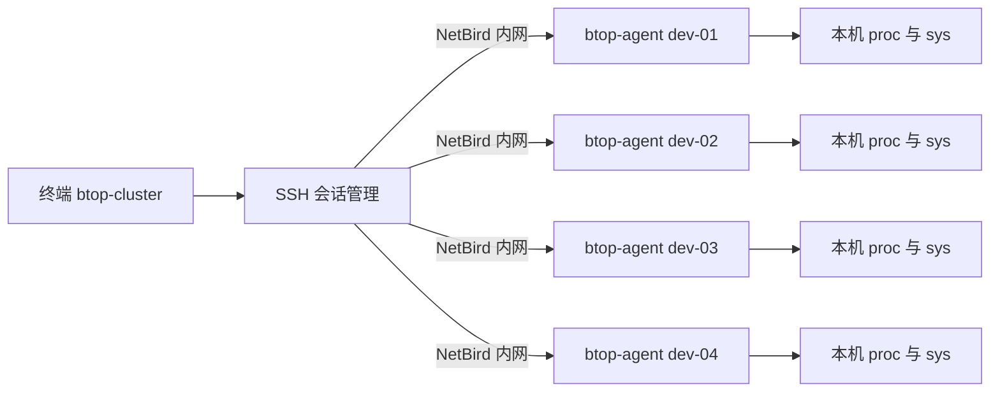

# btop 四机终端监控方案

> 2026-11-05：0.4.0 已实现三机 HTTPS 集中接入，每机 agent 上报、中心缓存、各机 TUI 独立查看。启动和配置见 [HTTPS 使用说明](https.md)，架构见 [接入设计](centralized-https.md)。本机／SSH 模式继续保留；真实三机部署尚待确认目标和架构。

本文保留总体设计与目标，当前已实现范围以[使用说明](prototype.md)为准。实现使用单线程非阻塞会话循环；本机模式通过管道启动 agent；趋势保存 300 点。下面的时间对齐、事件队列、精确数据年龄和配置文件属于后续计划。

## 目标与范围

让开发者在一次终端会话中比较 4 台机器的空闲程度，判断任务适合放在哪台机器，并进入某台机器查看资源占用。界面复用 btop 的实现和主题文件，布局围绕多机观察重新组织。

首版以 Linux 主机、4 台机器、单个观察者为验收范围。客户端可以运行于其中任意一台，也可运行于加入同一 NetBird 网络的第五台 Linux 机器。本机模式直接通过管道启动 agent，SSH 模式使用远端进程；二者共享同一协议与采集口径。

| 能力 | 首版范围 |
| --- | --- |
| 总览 | 4 台机器同时显示 CPU、内存、Swap、load、磁盘、网络和数据新鲜度 |
| 单机详情 | CPU 总体／各核心、内存、磁盘／网卡列表、进程 Top N |
| 交互 | 主机切换、详情返回、进程排序／过滤、网卡／磁盘选择、手动重连 |
| 历史 | 当前客户端会话内最近 10 分钟，按时间对齐；退出不保存 |
| 故障 | 连接超时、断线、认证失败、字段缺失和采集超时可见 |
| 扩展 | 数据结构不硬编码 4 台；超过 4 台的分页交互后续实现 |

首版不含告警推送、数据库、长期历史、远程进程控制、容器配额视图、GPU／NPU 采集。这些能力不影响首版四机负载监控的闭环。

## 架构



箭头表示连接／读取方向；每条 SSH 连接的 stdin 传订阅命令，stdout 返回 JSON Lines。NetBird 提供网络可达性，SSH 提供登录及远程进程通道。NetBird 内置 SSH 与系统 sshd 是不同的接入方式，首版默认使用内网地址上的系统 sshd；如果现有环境使用 NetBird 内置 SSH，则先验证它的非交互认证流程。[NetBird 官方说明](https://docs.netbird.io/manage/peers/ssh)

不需要额外 HTTP 服务或中心数据库。4 个采集进程分别只观察所在主机，现有单机采集状态天然隔离；客户端负责多主机的独立数据模型。采集端退出不影响开发任务。

## 源码复用方式

采用独立 CMake 目标 `btop-cluster` 和 `btop-agent`，保留原版 `btop` 目标。具体文件和接口见[实施方案](implementation.md)。

| 现有代码 | 复用策略 |
| --- | --- |
| `themes/`、`src/btop_theme.*` | 复用主题格式、渐变色和加载逻辑；配置目录改为衍生项目自己的目录 |
| `Draw::createBox`、`Draw::Graph`、`Draw::Meter` | 提取通用绘制实现，共享给原版和新界面；图形缓存归每张卡片所有 |
| `src/btop_tools.*` 的终端工具 | 复用终端模式切换、光标控制、字符宽度工具，保持清理恢复路径 |
| `src/linux/btop_collect.cpp` | 分阶段提取无界面采集核心；原版保留适配层，新 agent 使用独立入口 |
| `Cpu/Mem/Net/Proc::draw` | 首版不整段调用这些全局状态面板；详情页复用其视觉组织和通用绘制组件 |
| `src/btop_input.*`、`src/btop_menu.*` | 研究按键体验，新客户端建立自己的只读按键映射 |

原版面板除了接收指标，还读取全局几何位置、CPU 核数、网卡选择、配置和图形缓存。四次调用同一 `Cpu::draw` 不能自然得到四个独立面板。采集器也按面板宽度截断历史，直接在无终端进程中调用需要先拆除这种依赖。依据见[源码调研](source-study.md)。

采集端提取核心的原则：持有前一次计数器和采样时间、输出当前规范化指标；趋势保留长度由客户端决定。避免把含 `deque`、布局变量、文件路径对象的上游内存结构直接序列化为网络协议。

## 客户端状态与并发

每台主机持有 `HostSession`、`HostSnapshot`、`HostHistory`、`HostViewState` 四个对象；主机 ID 来自本地配置，禁止远端消息改写 ID 或路由。

- 一个非阻塞 I/O 循环使用 `poll` 管理 4 个 SSH 子进程的 stdin、stdout、stderr，并执行重连计时。
- 解码后发布不可变快照，经有界事件队列交给 UI 线程；UI 每帧读取一份一致快照。
- 每台机器最多保留 2 个待显示快照，满时替换未显示的旧快照。消息仍完成边界解析，禁止截断半帧。
- UI 线程独占终端输出、主题状态和图形对象；网络线程不能调用 btop 绘制函数。
- 每个图表缓存以主机、指标、网卡／设备身份、尺寸和主题版本为键，切主机或缩放不会串数据。
- 采集、接收、绘制分开计时。网络卡住不会阻塞按键和其他主机。

agent 将 CPU／内存快速采样和可能变慢的文件系统容量查询分开。容量工作进程只查询选定的本地挂载，超过 1 秒返回该组超时状态；同一主机最多一个容量工作进程，不为未退出的阻塞查询无限创建替代进程。进程扫描也有时间预算，超时返回 partial，避免拖延核心指标。

## 总览界面

以下是布局示意，数值为虚构数据；最终颜色和曲线字符直接取自 btop 主题和绘制组件。

```text
 btop-cluster    3/4 ONLINE                         interval 2s
╭─ 1 dev-01 · ONLINE · 0.3s ───────╮ ╭─ 2 dev-02 · ONLINE · 0.5s ───────╮
│ CPU 76%  ▁▂▃▆█▆▅▄    32 cores  │ │ CPU 12%  ▁▁▂▁▂▁▁▂    64 cores  │
│ MEM 42 / 128 GiB      SWAP 0 B  │ │ MEM 18 / 256 GiB      SWAP 0 B  │
│ LOAD 12.3 / 10.1 / 8.2         │ │ LOAD 1.2 / 1.5 / 1.1            │
│ / 68%   nvme0n1  R 8 / W 2 MB/s│ │ / 42%   nvme0n1  R 0 / W 1 MB/s│
│ eth0     RX 12 / TX 3 MB/s      │ │ eth0     RX 1 / TX 0.2 MB/s     │
╰────────────────────────────────╯ ╰────────────────────────────────╯
╭─ 3 dev-03 · ONLINE · 0.4s ───────╮ ╭─ 4 dev-04 · STALE · 8.2s ────────╮
│ CPU / MEM / SWAP / LOAD         │ │ Last sample: 8.2s ago           │
│ Disk / Network / History       │ │ Reconnecting in 2s              │
╰────────────────────────────────╯ ╰────────────────────────────────╯
 Tab Select   Enter Details   1–4 Host   r Reconnect   q Quit
```

实际采用有界矩形布局，不以这段文本的宽度作为实现常量。每张卡片使用 `cpu_box`、`mem_box`、`net_box` 等主题色，离线状态同时展示文字，避免只靠颜色辨认。

| 终端尺寸 | 展示策略 |
| --- | --- |
| 至少 120 列、36 行 | 2×2 完整卡片；全部 4 台同时可见 |
| 至少 80 列、24 行，未达到完整卡片条件 | 四行主机摘要表，保留 CPU、内存、load 和在线状态；详情看磁盘／网络 |
| 低于 80×24 | 显示需要扩大终端的提示；连接和采集继续，不产生越界光标输出 |

详情页使用 CPU、内存、网络、磁盘、进程分区。`Esc` 返回总览；`Tab` 切换主机；进程列表支持 `c` 按 CPU、`m` 按 RSS、`/` 过滤。总览的 `1`–`4` 选中并打开对应主机，详情的 `1`–`4` 切换主机；不沿用原版数字键隐藏面板含义。所有按键在底栏／帮助页解释。

断线后保留最后读数并降亮显示，标注最后采样距今多久。时间曲线留缺口，不用零值冒充空闲；CPU 核数改变时重建核心图表，旧的总量历史可以继续保留但标出变化。

## 指标和选择规则

CPU 显示全机 0–100% 与在线逻辑核数；load 显示 1／5／15 分钟原始值，额外提供 `load1 / online_cores`。load 包含等待任务，不能直接当成 CPU 使用率。内存使用率以 available 为基础，具体口径见[协议](protocol.md)。

磁盘容量按挂载点展示，块设备吞吐按独立设备展示，不能把二者混为一项。当前网卡默认包含所有非 loopback 接口，详情用 `n` 逐个查看，包括可读的 NetBird 接口；不把隧道流量与承载它的网卡流量相加。后续可通过每机配置固定关注接口。

首版总览不扫描进程，进入详情时订阅进程列表，返回时取消。排序和过滤由 agent 在完整的可见进程集合上执行后截取 Top N；客户端显示总数、返回数、截断和权限受限状态，避免把局部列表称为全量结果。

## 技术取舍

| 选项 | 判断 |
| --- | --- |
| tmux 四分屏运行原版 btop | 可快速手工使用，但没有统一快照、重连管理和紧凑的四机布局 |
| Python／Textual 重绘 | 开发迭代方便，但要重新实现原版视觉组件；不符合本次直接复用源码的偏好 |
| 直接共享四套原版全局变量 | 耦合和串数据风险高，尤其涉及核心数、缓存、选中 PID；不采用 |
| btop 绘制组件＋独立多机数据模型 | 采用；视觉复用明确，远端协议和主机生命周期可单独验证 |
| 常驻 HTTP agent | 适合多人共享／长期监控，但增加端口、服务管理和认证；留待后续 |

多名观察者会各自启动 4 个 agent，采样开销随人数增加。首版接受这一边界；后续多人使用时再考虑共享守护进程。
