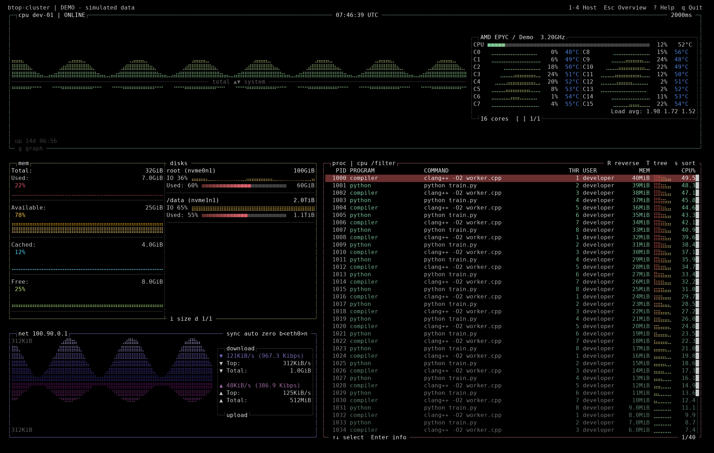

# 四机终端监控使用说明

当前 0.5.2 版已实现真实 Linux 采集器 `btop-agent`、本机管道模式、最多四条独立 SSH 连接，以及采用原版 btop 绘图组件的总览和单机详情。`--demo` 仍可运行四台模拟主机；只有该模式使用模拟数据。新增的 [HTTPS 集中模式](https.md) 支持 agent 主动上报、中心缓存和多个独立终端查看。

详情按提供的原版 btop 截图重排：顶部约三分之一为 CPU 双向历史图，右侧内嵌 CPU 型号、总量、逐核和负载信息；左下 MEM／DISKS 共用边框，下方为双向 NET 图及内嵌收发统计；右下整块为 PROC。操作提示放在边框及顶栏。以下 200×60 预览由程序的 `--demo --detail --once` 实际 ANSI 输出生成，使用模拟数据。



布局参考原版 btop；用户提供的参考截图仅保存在本地，不随仓库发布。

## 运行本机真实采集

从仓库根目录执行：

```bash
./build/cluster/btop-cluster --local --detail
```

客户端自动启动同一构建目录下的 `btop-agent --stdio`，退出时关闭采集通道。无需 root、SSH 或额外服务。首次 CPU／速率差分显示 N/A，下一次采样后显示读数；默认间隔 2 秒。

详情包含五个分区：

| 分区 | 当前内容 |
| --- | --- |
| cpu | 上下镜像曲线，默认 total／system；上图可切 user／system／iowait；内嵌 CPU 型号、总量条、逐核曲线／使用率／温度、load 和翻页；uptime、快照 UTC 时间及采样间隔 |
| mem | Total；Used／Available／Cached／Free 数值、百分比及全列宽度的历史曲线，与磁盘共用单一分隔线 |
| disks | 挂载名、总量、活跃度小图、使用率、容量条及已用量；启用的 swap 作为容量项；I/O 模式显示设备读写历史曲线和速率 |
| net | 上下镜像大图，右侧内嵌下载／上传统计框：速度、峰值、累计；宽度足够时同时显示字节／秒和比特／秒；接口 IP、自动／固定刻度、收发同尺度和显示计数归零 |
| proc | PID、程序、可随窗口加宽的命令列、线程、用户名、内存、CPU 及逐行小图；行颜色渐变、滚动条、选中高亮、六种排序、过滤、树视图和折叠 |
| 选中进程 | CPU／RSS 历史、状态、运行时长、父 PID、线程、nice、读写累计字节、命令；较大终端可显示三行命令 |

进程 CPU 以一个逻辑核为 100%，多线程进程可以超过 100%。客户端请求排序／过滤后的前 500 项，面板底部显示选中位置和匹配数，截断时标注 top。树视图基于返回集合构建，未返回的祖先无法显示；不是无限量的完整进程树。读取受限或扫描超过 250ms 标记 partial。总览不订阅进程；详情只为当前主机订阅。

行选择绑定 PID 和 start_time_ticks。打开详情后，即使进程跌出 Top 500 或被过滤，agent 也会在扫描到它时单独返回详情；退出／PID 重用显示身份变化，扫描预算或权限不足显示不可用。列表命令摘要最多 192 字节，选中进程命令最多 4096 字节，均处理不可显示字符；不读取环境变量。用户名来自启动时读取的本地 passwd 文件，未命中的 UID 显示数字，避免 NSS／LDAP 阻塞采样。

详情直接复用 `Draw::Graph`、`Meter`、`createBox` 和主题。鼠标操作、完整设置菜单、进程暂停／跟随菜单、远程进程控制、GPU 和电池尚未迁入。CPU 下图使用 system CPU 指标；上图选择 system 时，下图改为 user。温度只支持已识别的 hwmon 来源；逐核温度要求 coretemp 标签与 CPU package／core 拓扑匹配，不为其他 CPU 插入猜测数值。原版 `btop` 仍可独立运行。

## 按键与尺寸

| 按键 | 行为 |
| --- | --- |
| Tab、1–4 | 切换主机；数字键直接进入对应详情 |
| Enter | 从总览进入详情；详情中打开／关闭选中进程信息 |
| Esc | 依次关闭进程详情、返回总览；过滤输入中取消修改 |
| [、]；g | 逐核翻页；切换 CPU 总量／user／system／iowait 图 |
| d；i | 磁盘翻页；切换容量／I/O 图模式 |
| b、n | 上／下一张网卡 |
| a；y；z | 网络自动／固定 10MiB/s 刻度；收发同尺度／独立尺度；显示累计值归零 |
| ↑、↓ 或 j、k | 选择上一／下一进程 |
| PgUp、PgDn；Home、End | 每次移动 10 行；到首／尾行 |
| c、m；s；R | CPU／RSS 排序；循环 CPU／RSS／PID／名称／用户／线程排序；反向排序 |
| T；Space | 开关树视图；折叠／展开选中节点 |
| / | 编辑进程名、`user:用户名片段` 或 `uid:数字` 过滤条件，Enter 应用 |
| u | 打开／关闭当前主机登录账号列表，PgUp/PgDn 翻页 |
| v | 详情中切换 PROC / CARDS 焦点；方向键逐行，PgUp/PgDn 按可见行数翻页，Home/End 到首尾 |
| , / . | CARDS 上一页／下一页，自动展开并切换焦点；底边显示所选卡和页码 |
| Enter（CARDS 焦点） | 展开／关闭选中卡的占用与预留详情 |
| f（CARDS 焦点） | 按占用者 UID 精确筛选进程，转回 PROC |
| o | 折叠／展开卡表，为进程列表腾出空间 |
| ?；r；t；q | 按键帮助；重连；TTY 主题；退出 |

登录和卡资源的展示、数据源及升级顺序见 [资源监控](resources-monitoring.md)。
80×24 详情通过 `v` 在右侧 CARDS 与 PROC 间切换，大尺寸可同时显示。

至少 120×36 时总览显示 2×2 卡片，80×24 起使用紧凑摘要；详情在两种尺寸都包含五个分区。推荐 160×48 或更大；200×60 的比例和信息密度最接近参考截图。80×24 仍保留五个分区，但会省略命令／线程列、内存曲线和网络统计框等细节，逐核信息通过 `[ ]` 翻页。

过滤示例：按 `/`，输入 `user:dev`，再回车，显示 USER 列包含 `dev` 的进程，
例如 `developer`。用户名忽略大小写，采用字面子串匹配，不需要 `*`；`user:` 留空时不匹配
任何进程。普通关键词（例如 `python`）继续按进程短名称做大小写不敏感的子串匹配。
再次按 `/`，删除全部内容并回车可恢复全部进程。各主机和各查看终端的过滤条件独立。
用户过滤在采集器排序和截取前 500 条之前执行，需要被查看机器运行
`0.4.0-alpha.3` 或更新的采集器；只升级终端无法让旧采集器支持新语法。
USER 名称来自采集器启动时读取的 `/etc/passwd`；无法解析的 UID 仍显示为数字，
此时可按显示值筛选，例如 `user:1001`。这不是查询其他机器的登录账号。

磁盘容量通过 mountinfo 的 major:minor 匹配 diskstats，包括有 sysfs 记录的分区；无法直接匹配的 overlay／特殊文件系统标记 I/O unmapped，不借用其他设备读数。容量自动查询 `/` 及 ext3／ext4／xfs／btrfs 挂载；I/O 模式逐个展示块设备，不叠加整盘与分区读写量。网卡默认包含非 loopback 接口，不将隧道与承载网卡流量相加。`z` 只调整当前客户端显示偏移，计数回退／接口身份变化后重置峰值及偏移。

## 四机 SSH 模式

在各机装好同架构、运行库兼容的 agent 并配置可用 SSH 别名后：

```bash
./build/cluster/btop-cluster \
  --ssh dev-01 --ssh dev-02 --ssh dev-03 --ssh dev-04
```

远端默认路径为 `/opt/btop-cluster/bin/btop-agent`，可用 `--agent-path /absolute/path/btop-agent` 统一覆盖四台机器的路径。SSH 使用已有用户配置和认证，开启 BatchMode 和严格主机密钥检查。一台连接失败时其他主机独立采集；网络故障自动退避重试，认证／协议错误可修复后按 `r`。

完整接入步骤见[部署说明](deployment.md)。当前尚未部署或连接用户指定的三台真实开发机；自动测试通过本地假 SSH 进程验证四路传输及单机故障隔离。`--config` 已用于 HTTPS 模式；`examples/cluster.example.json` 仍为早期 SSH 配置草案，不适用于 HTTPS。

## 其他命令

```bash
# 原版主题与 256 色
./build/cluster/btop-cluster --local --detail --theme themes/dracula.theme
./build/cluster/btop-cluster --local --low-color

# 四台模拟主机
./build/cluster/btop-cluster --demo --detail
# 三台模拟服务器，第四格显示集群汇总
./build/cluster/btop-cluster --demo --demo-hosts 3

# 一帧真实详情；等待有效 CPU 差分后输出 ANSI，超时返回非零
./build/cluster/btop-cluster --local --detail --once --width 120 --height 36

# 一次真实 JSON 快照；250ms 基线窗口，包含所有详情组
./build/cluster/btop-agent --once
```

`--interval-ms 1000..10000` 同时适用于本机、SSH 和演示模式。CPU 总量／分项／逐核、内存分类、磁盘、网卡、返回进程及选中进程的曲线各保留最近 300 个采样点；默认约 10 分钟，修改间隔会改变实际时间跨度。断线清除趋势并保留旧快照及连接状态。当前尚未实现精确时间对齐、数据年龄显示和历史落盘。

## 构建

本机为 Linux aarch64，使用已有 GCC 15.2.1、项目内部 CMake 3.31.10、系统 nlohmann/json 3.11.3、OpenSSL 3.0.8、GTest 和 Python 3。HTTPS 使用固定的 cpp-httplib v0.64.0。CMake 工具包来自官方 GitHub 发布页，SHA-256 已与官方记录核对：

```text
cmake-3.31.10-linux-aarch64.tar.gz
a343c6294f770742904e6a6792e0956b5ff8212abfb63cac99237de2e210fa0f
```

项目根目录下的已验证命令：

```bash
BTOP_CMAKE=.tools/cmake-3.31.10-linux-aarch64/bin/cmake
"$BTOP_CMAKE" -S . -B build/cluster -G Ninja \
  -DCMAKE_CXX_COMPILER=g++-15 \
  -DCMAKE_BUILD_TYPE=Release \
  -DBTOP_GPU=OFF -DBTOP_LTO=OFF \
  -DBTOP_CLUSTER=ON -DBUILD_TESTING=ON
"$BTOP_CMAKE" --build build/cluster --parallel 2
.tools/cmake-3.31.10-linux-aarch64/bin/ctest \
  --test-dir build/cluster --parallel 2 --output-on-failure
```

`BTOP_CLUSTER` 使用 `find_package(nlohmann_json 3.11 REQUIRED)`，需预装其 CMake 包；当前未 vendoring 或自动下载。没有已安装 GTest 时，原版 CMake 会尝试 FetchContent 下载；无网构建需预置依赖。其他机器使用满足 CMake ≥3.25 和 C++23 要求的对应架构工具链。

工具包与产物位于忽略的 `.tools/`、`build/` 中，未替换系统程序。此前构建依赖本机 GCC 15 运行时；发布构建现可静态链接 C++ 运行库，并校验实际 glibc 要求，见 [发布说明](release.md)。

## 实现与验证

- 绘图和主题：`src/btop_draw_primitives.cpp`、`btop_render_support.cpp`、`btop_theme.cpp`；兼容入口保留原版调用。
- 无终端采集：`src/collector/linux.*`、`filesystems.*`；CPU／内存沿用 btop 计数口径，使用独立实例保存差分基线，原版 Linux collector 保留。
- 协议与 agent：`src/protocol/protocol.*`、`src/agent/main.cpp`；v1 NDJSON、订阅、分组错误和输出阻塞超时。
- 客户端：`src/cluster/session.*` 负责本机／SSH 生命周期，`model.cpp` 保存每主机历史及选择状态，`view.*` 与 `detail.cpp` 绘制对应快照。

2026-11-05，在固定上游提交 `e28a2701c7208ff00ab780a68287e2204f356ba0` 基础上，原版 btop、btop-cluster、btop-agent 和 btop-server 均构建成功，24 项 CTest 全部通过：

- 原有测试、绘图接口逐字节兼容、图形隔离、布局和重绘不改历史。
- CPU guest／分项、实际间隔、PID 重用；CPU 型号／uptime、跨 socket 温度隔离、分区计数与 I/O 活跃度、选中进程过滤外返回及身份检查；协议分帧／重复键／uint64／边界。
- 远端名称的控制字符处理、UTF-8 显示宽度截断；进程树缺失父节点／环、折叠、选择及 PID 重用后的历史隔离。
- 真实 agent 订阅／采样／过滤／停止，本机实时详情和四路假 SSH；其中一路失败时三路仍在线。
- 本机真实 HTTPS 三 agent／三终端、CA 和主机名校验、角色／主机／查看权限、消息序号、独立进程查询、离线与租约过期、中心重启恢复。
- 80×24、100×30、120×36、160×48、200×60 详情绘制；PTY 实际进入进程详情、树视图、磁盘 I/O、CPU 分项及帮助后的边界；按键、缩放、慢输出、退出和信号后的终端恢复，原版 btop 启动回归。

agent 符号检查未发现 Draw／Theme／Term／Config 实现。真实四机、长期运行、发行包 ABI 和性能预算尚待验收。

预览导出工具位于 `tests/render_preview.py`，额外使用 Pillow 和 DejaVu 字体；可指定列数和行数，例如 `python tests/render_preview.py build/cluster/btop-cluster /tmp/detail.png 200 60`，不参与产品运行或常规构建。终端采用非阻塞输出，一帧写完后再显示最新待绘制帧，最多保留当前及下一帧，终端读取慢时不阻塞输入和信号退出。

## 刷新与防闪烁

交互模式先在内存中解析 btop 的绘图输出，比较前后屏幕的字符、颜色及样式，只发送变化的位置。清屏只用于首次绘制、终端恢复和尺寸变化；常规采样、进程选择、主题／页面切换不先擦空画面。支持同步输出的终端还会将同一帧合并显示；不支持该扩展时，仍使用差分更新。

部分写入必须完成后才计算下一帧差分，积压时仅替换尚未开始的待绘制帧，避免跳帧后遗留旧字符。退出会结束同步输出、恢复光标和终端属性。`--once` 仍输出可独立回放的完整 ANSI 帧。

新增检查覆盖重复帧无输出、颜色变化、中文宽字符／组合字符、文字变短、界面和主题切换后与完整帧一致、周期刷新无清屏、缩放以及慢终端中断恢复。PTY 回归检查常规采样不发清屏指令、固定顶栏不重复发送，且周期差分输出小于首次绘制；输出字节数随窗口、主题和数据变化。
