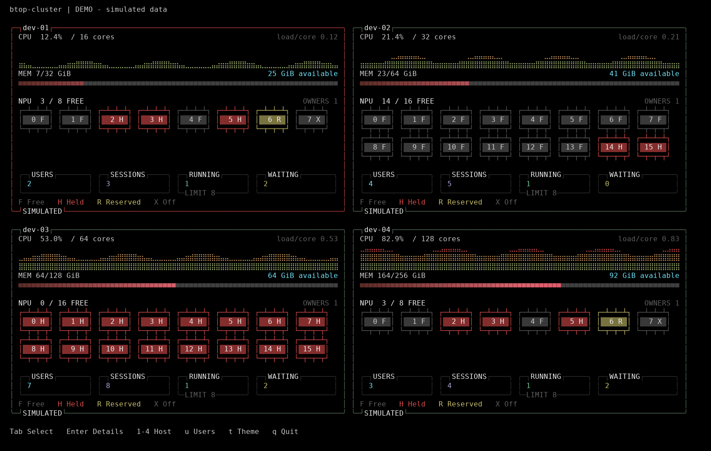
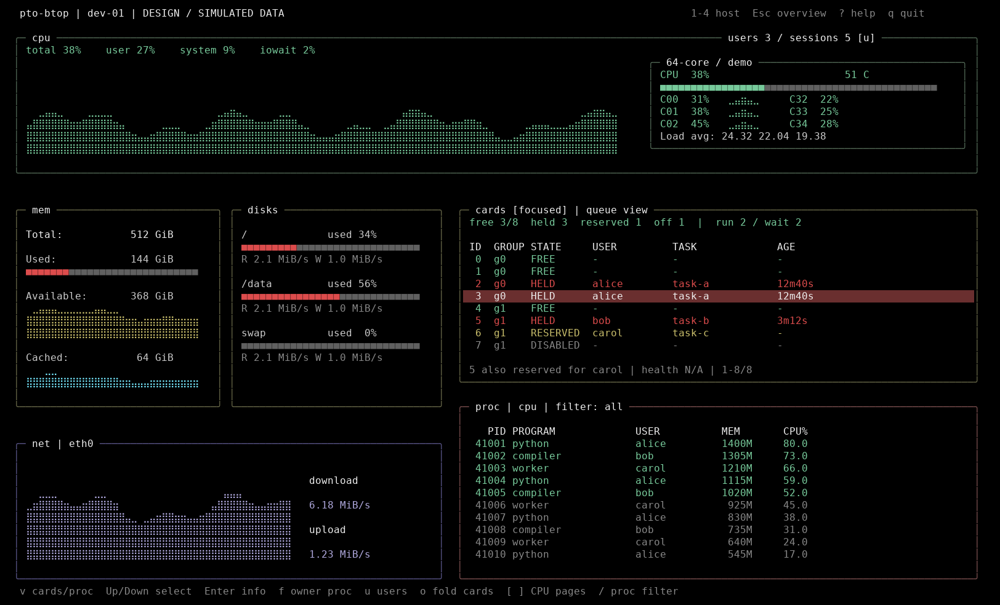

# 登录用户与卡资源监控

状态：从 `0.5.0` 开始实现。2026-11-05。
总览图由当前程序使用模拟数据生成；详情设计图保留作布局参考。
实际终端详情预览见 [项目首页](../../README.md)。

## 确定的需求

- “在线人数”按当前登录账号去重，同一账号多次登录计一人，另显示会话总数。
- 总览同时比较 CPU、可用内存、卡资源、排队任务和登录人数，帮助选择服务器。
- 卡资源以 `task-submit` 的分配状态为依据，明确占用者和不能分配的原因。
- 详情保留 CPU、MEM、DISKS、NET、PROC；新增区域沿用 btop 的终端边框、主题和键盘交互。

## 总览：每台主机卡片增加资源摘要



每张卡片自上而下显示：

1. 主机名和连接状态。
2. CPU 百分比与短历史；load1 / 核数用于比较不同核数的主机。
3. 内存 used / total，同时明确 available；不能只比较已用百分比。
4. NPU 空闲／总数及占卡账号数。
5. 每张卡一个带实际编号的芯片图标：占用红色填充、空闲灰色、预留黄色、禁用灰色 X。
   F / H / R / X / E / ! / ? 分别表示空闲、占用、预留、禁用、外部占用、错误、未知；
   过期数据统一改为灰色 ?，不能沿用旧的空闲结论。图标随卡数自动换行，
   120×36 缩为单行小格；超出可显示区域时明确标出还有多少张，并在详情查看。
6. 底部四个数字框分别突出 USERS、SESSIONS、RUNNING（当前任务数）、WAITING；
   RUNNING 下方用灰色 LIMIT 标签单独注明并发上限，避免与占卡数混淆。
   登录人数与占卡人数分开显示。partial 登录计数用 ~ 标记，未知数值显示 --。

这里的 free 是**全局队列池中未被占用、未被预留的资源**，不是任务立即启动的承诺。
维护、调度器离线、并发上限和已有队列仍可能阻止新任务启动。没有硬件健康数据时，
free 也不代表硬件健康已经验证；面板明确采用队列视角。

总览保持主机顺序稳定，避免数据刷新时焦点跳到另一台机器。第一版不生成不透明的
“综合负载分”。CPU 很低但没有空闲卡的主机，不应呈现为适合跑 NPU 任务。
展示 `free`、`waiting`、CPU、可用内存供使用者直接判断。后续可增加显式排序和
按“需要 N 张、是否同组”筛选，但不能用总空闲数推断某个多卡任务一定能运行。

## 详情：右侧上方 cards，下方 proc



从右侧 PROC 分出空间，而不替换 DISKS：卡列表需要同时容纳卡号、状态、用户、
任务和持续时间，现有磁盘半栏太窄；卡占用者与进程列表也更便于上下联动。

```text
┌ cpu：历史曲线、逐核状态、load ───────────── users 3 / sessions 5 ┐
│                                                               │
└───────────────────────────────────────────────────────────────┘
┌ mem ─────────┬ disks ─────────┐ ┌ cards：摘要、逐卡表、占用者 ───┐
│              │               │ │ ID  STATE  USER   TASK  AGE   │
│              │               │ │  3  HELD   alice  task-a 12m │
│              │               │ └──────────────────────────────┘
├ net ─────────────────────────┤ ┌ proc：原进程列表与过滤 ────────┐
│                              │ │ PID PROGRAM USER MEM CPU     │
│                              │ │                              │
└──────────────────────────────┘ └──────────────────────────────┘
```

- CPU 区右上角显示登录账号数和会话数，`u` 打开账号小窗：USER / SESSIONS / SINCE。
  退出小窗恢复原选择。第一版不显示来源 IP，也不把进程所有者当成登录用户。
- cards 表列为 ID、GROUP、STATE、USER、TASK、AGE；8 张卡通常完整显示，16 张及以上分页。
- 用户取**提交者**，不能取 root daemon 或执行身份。预留行同时说明“为谁等待”；
  已占用卡还可以属于某个预留池，不能把“正在用的人”和“等待的人”合并为一个字段。
- 新增 `v` 在 PROC 与 CARDS 之间切换焦点；焦点边框变亮，方向键只移动当前面板。
  `↑` / `↓` 逐行选择，`PgUp` / `PgDn` 按当前可见行数翻页，`Home` / `End` 到首尾。
  也可直接按 `,` 上一页、`.` 下一页，自动展开 CARDS 并切换焦点，无需先按 `v`。
  底边显示所选卡序号与页码（例如 `4/8 p2/3`），缩放终端或展开详情后按实际行数分页。
  保持现有 Tab 切主机、数字切主机、`[` / `]` 翻 CPU 页的行为。
- CARDS 获得焦点时，Enter 展开选中卡的只读详情；`f` 跳到占用者进程。
  联动使用 `uid:数字` 等值过滤，不能简单拼 `user:alice`，否则现有模糊匹配还会包含
  `alice-ci`。用户名手动输入的 `user:` 仍保持当前模糊包含语义。
- `o` 折叠 cards 的表格，只留摘要，为 PROC 腾出高度；每个主机独立记忆状态。
- 打开 PROC 进程详情时暂时使用右侧完整高度，关闭后恢复卡表与进程表。
- 不加入分配、抢占、取消任务、杀进程等操作。

按键作用于当前主机；其它查看者的选择和过滤条件不受影响。

## 尺寸与主题

| 尺寸 | 展示 |
| --- | --- |
| >=160×48 | CPU 占约 30%；左下 MEM / DISKS / NET；右下 CARDS 约 12–15 行，其余为 PROC，至少保留 8 行进程 |
| 120×36 | 同一布局；CARDS 表显示 4 行并分页，隐藏 TASK 的长文本；PROC 保留至少 6 行数据 |
| 80×24 | 总览改紧凑表，保留 CPU、MEM、free/total、wait、users；详情 CARDS 默认只显示一行摘要，`v` 切换右侧 CARDS / PROC，避免同时挤压两个不可读的表 |
| <80×24 | 延用已有扩大终端提示；不越界绘制 |

总览使用灰色空闲卡、红色占用卡和黄色预留卡；底部数字框沿用主题色。
详情 CARDS 复用 `mem_box` / `proc_box` 相邻色系；空闲绿、占用红、预留黄、禁用灰、
异常亮红、未知或过期用灰色问号。每种状态都有文字或字母，TTY 模式不依赖颜色。
所有布局仍按字符矩形计算，复用现有主题、图表和帧差分输出，避免新增整屏清除或闪烁。
用户、任务和设备名称仍经现有终端控制字符清洗及显示宽度裁剪。

## 数据来源与边界

登录统计由 pto-btop agent 采集 Linux 登录记录（utmpx 的 USER_PROCESS），不依赖
`task-submit`。按本机账号去重，输出 users、sessions 和每账号会话数。只表示系统
登记的登录会话，不判断人是否正在键盘前；未登记的非交互连接不保证被计入。
没有登录记录数据源或没有读权限时显示 N/A，不能把查询失败显示成 0 人。
账号与会话数正常为 0 时则明确显示 0。后台任务运行者与登录人数分开统计。

`sessions` 组沿用现有 `{status, observed_monotonic_ms, interval_ms, data}` 包装。
正常 data 为 `{source: "utmpx", users: 3, sessions: 5, items: [...]}`，items 每个账号
包含 user、sessions、first_login_at（最早登录的 Unix 秒数，未知为 null）；
另有 age_ms 表示观察年龄。去重按登录账号名，不调用 NSS 查询 UID。

卡数据优先由每台 agent 在本地运行固定 argv 的只读查询：

```text
/usr/local/bin/task-submit --monitor --json
```

这是 task-submit 提供的只读接口，详见 [接口约定](task-submit-monitor-api.md) 与
[完整虚构样例](examples/task-submit-monitor.example.json)。它读取 daemon 发布的
一致快照，不修改队列、竞争设备锁、运行硬件重置或扫描任务环境文件。

```text
Linux 登录记录 ───────────────────────┐
task-submit --monitor --json ──────────┤→ 本机 pto-btop-agent → 现有 HTTPS 中心 → 各终端
                                      ┘
```

不需要给 task-submit 新开公网/NetBird HTTP 端口。跨机传输继续复用现有 HTTPS、
认证和主机权限。若以后已有本地 Unix socket，可替换本地查询入口而保持 JSON 结构。

agent 按基础采样周期检查，每隔至少 5 秒刷新登录和卡数据，所有查看者共用采样。查询在有超时的独立 worker 内
执行，接口应在 500ms 内返回、1 秒硬超时、单次 stdout <=256KiB；失败不阻塞 CPU、
网络、进程采样或键盘。卡数据单独保存真实观察时间，超过 15 秒或 daemon 离线时
标记 STALE / UNKNOWN，取消绿色可用结论，保留旧值时标明“last”，不刷新其年龄。
未安装 task-submit 的机器显示 `cards unavailable`，其它监控正常运行。

## 升级和兼容性

1. 先升级并重启中心，再升级每台 agent / TUI。新中心接受原来 5 个基础指标组，
   以及可选的 sessions/cards；注册响应的 metric_groups 声明这两个新组。
2. 新 agent 遇到没有能力声明的旧中心，只上传原 5 组；旧 agent 接入新中心照常工作。
   未更新节点的新增字段显示 N/A，不影响 CPU、内存、磁盘、网络和进程。
3. 原有证书、令牌和节点配置保持不变。task-submit 查询只在 agent 所在机器执行，
   不需要 sudo；命令须安装在 `/usr/local/bin/task-submit` 并支持 schema_version 1。
4. 查看占用者时复用每个查看者独立的进程订阅，发送 `uid:1000` 这类精确 UID 过滤。
   目标 agent 必须为 0.5.0 或更新版本；旧版本不支持 UID 过滤。
5. worker 只向外转发接口白名单字段。monitor 的 daemon PID、内部状态路径等诊断信息
   不进入 cards 数据；标准输出限制为 256KiB，独立查询超时为 1 秒。

## 验证范围

测试覆盖登录账号去重、多会话、缺失和损坏记录；非连续卡号、占用与预留叠加、
计数一致性、旧快照、超时、异常退出和超大输出；旧中心能力协商、旧 agent 接入、
HTTPS 独立 UID 过滤；80×24 / 120×36 / 160×48 / 200×60 的焦点、分页、折叠和增量刷新。
第一版不采集 NPU 温度、利用率或队列外进程，不据此推断硬件健康。
